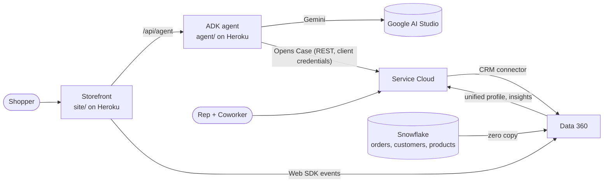

# Westerly Market × Salesforce Data 360

A demo of a grocery retailer, Westerly Market, whose shopper, order and service data come together in Data 360.
A shopper browses the storefront and chats with a Google ADK agent that builds a cart from the catalog. When they
need help with an order, the agent opens a Case in Service Cloud. The rep then sees the unified shopper profile,
order history and web activity on the Case, and asks Agentforce Coworker what the knowledge base allows.

All customer data in this repo is synthetic. No credentials, keys or org IDs are stored here; org-specific values
are placeholders (see [Placeholders](#placeholders)).

## What's in the repo

| Folder | What it is |
|---|---|
| [`site/`](site) | Storefront (`index.html`, `script.js`, `styles.css`) and a no-dependency Node server (`server.js`) for Heroku. Sends Web SDK events to Data 360 and proxies the chat widget to the agent at `/api/agent`. |
| [`agent/`](agent) | Google ADK agent (Python, Gemini) served by `uvicorn` on Heroku. Tools: `search_catalog`, `add_to_cart`, `create_support_case`. |
| [`setup/snowflake/`](setup/snowflake) | Snowflake DDL, synthetic seed data and the read-only role/user for Data 360 zero copy. |
| [`setup/data360/`](setup/data360) | Request payloads for every Data 360 change (streams, mappings, identity resolution, calculated insights, Web SDK, transforms), numbered to match the setup log. |
| [`setup/salesforce/`](setup/salesforce) | Salesforce DX project: Case and Contact fields, LWCs (shopper card, Shopper 360, case web activity), Apex controller, permission sets, queue, tab, record pages. Also sample-data Apex scripts and before/after backups of changed pages and flows. |
| [`setup/agentforce/`](setup/agentforce) | Order-status flows and the Westerly Support Agentforce agent (DX project plus agent spec). |
| [`setup/slides/`](setup/slides) | Generator for the architecture deck. |
| [`docs/`](docs) | [`SETUP_LOG.md`](docs/SETUP_LOG.md), the step-by-step record of how everything was built, and the architecture deck `westerly-architecture.pptx`. |

## Architecture



## Prerequisites

- A Salesforce org with Data 360, Service Cloud and Agentforce (Coworker) enabled, and the `sf` CLI signed in to it.
- A Snowflake account (role that can run the setup script as `ACCOUNTADMIN`).
- Two Heroku apps: one for `site/` (Node 20), one for `agent/` (Python 3.14).
- A Google AI Studio API key (Gemini).

## Setup order

Follow [`docs/SETUP_LOG.md`](docs/SETUP_LOG.md) top to bottom. Each step lists what was done, how it was checked
and its known gaps (🟡). In short:

1. **Tooling and org access** (step 0).
2. **Snowflake**: run [`setup/snowflake/westerly_snowflake_setup.sql`](setup/snowflake/westerly_snowflake_setup.sql),
   then the customer name and contact scripts. Create the Data 360 key pair yourself and paste only the public key
   into the commented `ALTER USER … RSA_PUBLIC_KEY` line.
3. **Data 360** (steps 1–7, 9–11): Snowflake connection and zero-copy streams, mappings to the data model, identity
   resolution, calculated insights, Web SDK connector, unified profile page. Payloads are in `setup/data360/`.
4. **Storefront** (step 8): deploy `site/` (see below), with your Web SDK connector ID in `site/index.html`.
5. **Google agent** (step 12): deploy `agent/` (see below).
6. **Salesforce metadata** (steps 13–15): deploy the DX projects.
   ```bash
   cd setup/salesforce && sf project deploy start --target-org <ORG_ALIAS>
   ```
   ```bash
   cd setup/agentforce/sfdx && sf project deploy start --target-org <ORG_ALIAS>
   ```
   Then create the External Client App and integration user for the agent, as step 15 describes. Set the agent
   user in `Westerly_Support.agent` before deploying it.

## Deploying to Heroku

Each app deploys from its own folder. One way is `git subtree` from this repo's root:

```bash
git subtree push --prefix site https://git.heroku.com/<site-app>.git main
```

```bash
git subtree push --prefix agent https://git.heroku.com/<agent-app>.git main
```

Config vars (set them in the Heroku dashboard or with `heroku config:set`; never commit them):

| App | Config var | Value |
|---|---|---|
| site | `AGENT_URL` | `https://<agent-app>.herokuapp.com` |
| site | `AGENT_SHARED_SECRET` | a long random string, e.g. `openssl rand -hex 32` |
| agent | `AGENT_SHARED_SECRET` | the same string |
| agent | `GOOGLE_API_KEY` | Google AI Studio key |
| agent | `SF_DOMAIN` | `<MY_DOMAIN>.my.salesforce.com` (no `https://`) |
| agent | `SF_CLIENT_ID`, `SF_CLIENT_SECRET` | External Client App, client credentials flow |

Checks: `GET https://<agent-app>.herokuapp.com/health` returns `{"ok":true}`. A 401 on the site's `/api/agent`
means the two secrets don't match, 503 means the site's vars are missing, 502 means `AGENT_URL` is wrong or the
agent is down.

## Running locally

```bash
cd site && node server.js
```

Opens on http://localhost:5173. For the agent, copy `agent/westerly_agent/.env.example` to `.env` in the same
folder, fill it in, then:

```bash
cd agent && python -m venv .venv && .venv/bin/pip install -r requirements.txt && .venv/bin/uvicorn main:app --port 8000
```

Point the site at it with `AGENT_URL=http://localhost:8000` and the same `AGENT_SHARED_SECRET`.

## Placeholders

| Placeholder | Where | Replace with |
|---|---|---|
| `<WEB_CONNECTOR_ID>` | `site/index.html`, setup log | Data 360 Web SDK connector ID |
| `<ORG_ALIAS>`, `<MY_DOMAIN>` | setup log, commands | your `sf` alias and My Domain |
| `<CONSUMER_KEY>` | setup log | External Client App consumer key |
| `<SNOWFLAKE_CONNECTION_ID>` | `setup/data360/` | Data 360 Snowflake connection ID |
| `<HEROKU_APP_URL>`, `<site-app>`, `<agent-app>` | setup log, this file | your Heroku apps |
| `<USER_ID>`, `<USER_NAME>` | exported Data 360 payloads | not needed to re-create; left from the export |

## Known gaps

- The product catalog exists three times with nothing syncing them: `CATALOG` in `site/script.js`,
  `agent/westerly_agent/catalog.json` and Snowflake `INVENTORY.PRODUCTS`. Change all three together.
- The agent writes recipes from Gemini's own knowledge, then matches ingredients to the catalog with `search_catalog`.
- The shopper's name, last order and usual items come from the demo profile in `site/script.js`, not Data 360.
- Agent conversations are in memory and reset when the dyno restarts. No rate limiting.
- Steps marked 🟡 in the setup log list their open items.
